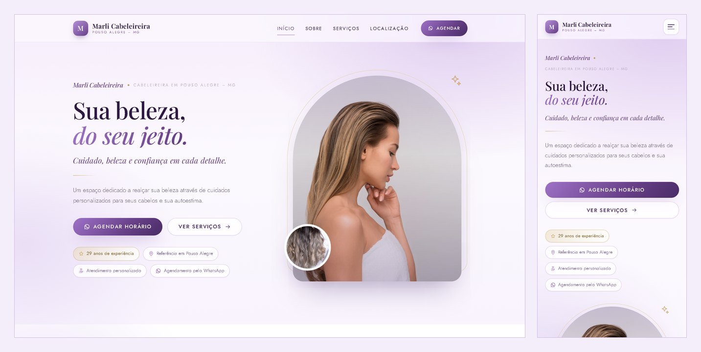
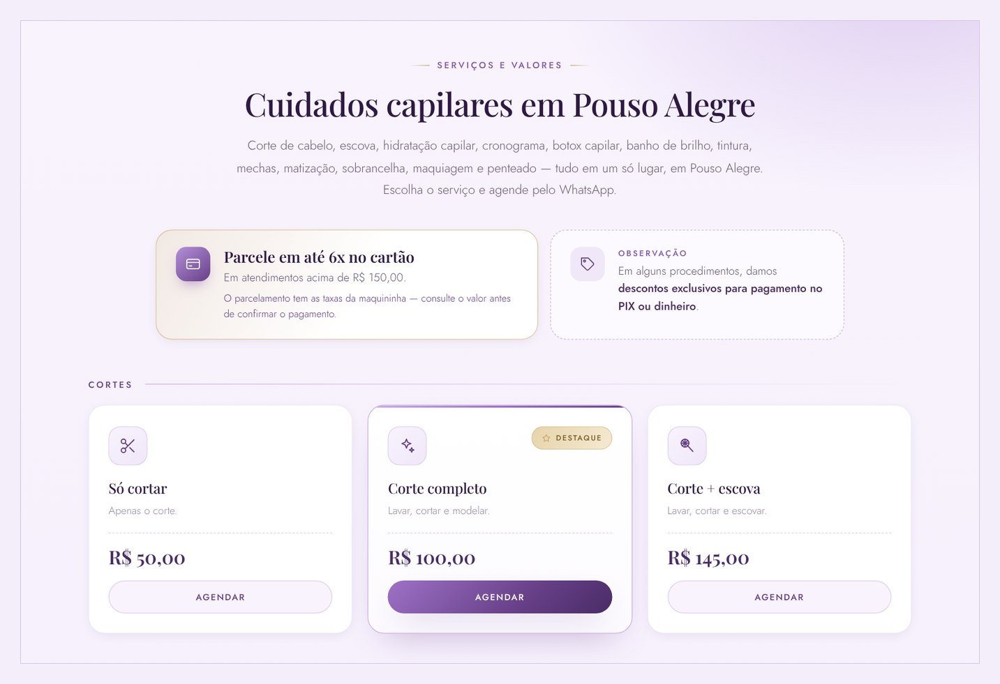
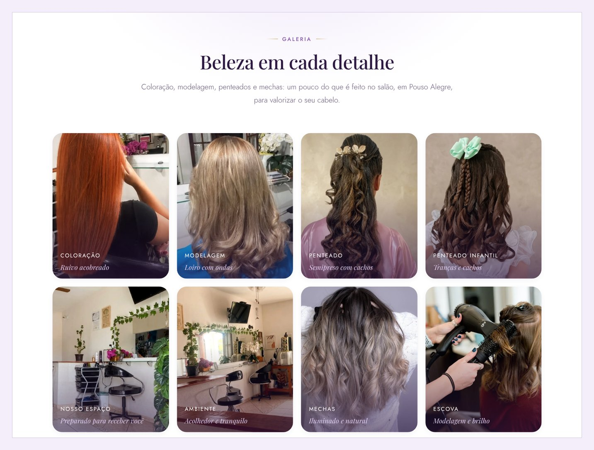

# Marli Cabeleireira — Catálogo Digital

Catálogo digital de serviços do **Marli Cabeleireira**, salão de beleza em
Pouso Alegre – MG, com 29 anos de experiência, com agendamento pelo WhatsApp.
Projeto desenvolvido pela **AXIS**.

🔗 **[www.marlicabeleireira.com.br](https://www.marlicabeleireira.com.br)**

---

## O desafio

O salão não tinha presença digital. Os agendamentos dependiam de indicação e
de quem já tinha o WhatsApp da Marli. Os objetivos eram dois:

1. **Transformar a visita em agendamento**: levar a pessoa da página para uma
   conversa no WhatsApp com o mínimo de atrito.
2. **Ser encontrado na busca local**, por quem procura cabeleireira ou salão de
   beleza em Pouso Alegre.

Todo o conteúdo — serviços, preços, marcas e fotos — veio do próprio salão.

## O que o catálogo entrega

- **28 pontos de agendamento pelo WhatsApp**, com a mensagem já escrita. Os
  botões de cada serviço enviam o nome do serviço junto, então a primeira
  mensagem já chega dizendo o que a cliente quer.
- **Tabela com 16 serviços** em 4 categorias, mais um pacote para eventos.
- **Formas de pagamento antes dos preços**: parcelamento no cartão e desconto no
  PIX ou dinheiro, num quadro visível antes do primeiro card.
- **Galeria com trabalhos reais** do salão.
- **16 perguntas frequentes**, cada uma pensada para um termo de busca — como
  "mechas em Pouso Alegre" ou "quanto custa uma escova" —, e que podem aparecer
  direto no resultado do Google.
- **Mapa**, com uma alternativa quando ele não carrega.
- **Medição de visitas e cliques** que mostra qual serviço gera mais procura,
  sem cookies e sem aviso de consentimento.
- **Prévia própria para compartilhamento**: quando o link é enviado no WhatsApp,
  aparece uma imagem feita para isso, e não um recorte automático da foto.

## Decisões técnicas

**Sem framework, sem dependências.** É uma página que precisa abrir rápido no
4G e ser fácil de manter. React ou Next.js acrescentariam etapa de build,
pacotes para atualizar e mais pontos de falha, sem trazer benefício para uma
página única. O site tem três arquivos de código: HTML, CSS e JavaScript.

**Carregamento leve.** O que o navegador baixa para mostrar o topo da página
soma cerca de 180 KB. As demais fotos só carregam quando a pessoa rola até elas.

**Imagens em WebP com reserva em JPG.** O peso total das imagens caiu de
1,28 MB para 0,72 MB. A compressão foi ajustada por foto: mais forte nas
miniaturas da galeria, que aparecem pequenas, e mais leve nas fotos grandes,
onde a textura do cabelo precisa aparecer.

**Responsivo de verdade.** Testado de 280 px (Galaxy Fold fechado) a 2560 px,
sem rolagem lateral. Tipografia fluida com `clamp()` e todos os alvos de toque
com no mínimo 44 px.

**Busca local.** Dados estruturados `HairSalon` e `FAQPage` (schema.org) com
endereço, telefone, faixa de preço, formas de pagamento e catálogo de serviços;
Open Graph; sitemap; propriedade verificada no Google Search Console. Inclui
também um `llms.txt`, que descreve o salão para assistentes de IA — hoje um
caminho real de descoberta, ao lado da busca tradicional.

**Acessibilidade.** Navegação completa por teclado, foco visível, link para
pular ao conteúdo, textos alternativos em todas as imagens, animações desligadas
para quem prefere menos movimento, e a página continua utilizável mesmo com o
JavaScript desativado.

**Testes automatizados.** Uma suíte abre a página num navegador real e roda
97 verificações antes de cada publicação. Entre elas: confere se o preço de cada
serviço é o mesmo no card, nos dados para o Google e nas respostas das perguntas
frequentes — é exatamente onde um preço desatualizado costuma passar
despercebido.

## Tecnologias

HTML, CSS e JavaScript puros · Schema.org (JSON-LD) · Playwright para os
testes · Umami para a medição · hospedagem na Netlify.

## Código

O código-fonte está em repositório privado. Para conhecer o projeto em mais
detalhes ou ter um site como este para o seu negócio, fale com a AXIS.

## Contato

**AXIS** — [Chamar no WhatsApp](https://wa.me/5535999755191?text=Ol%C3%A1!%20Vi%20o%20projeto%20do%20Marli%20Cabeleireira%20no%20GitHub%20e%20gostaria%20de%20um%20site%20para%20o%20meu%20neg%C3%B3cio.)

---

Fotos: acervo do salão e [Unsplash](https://unsplash.com). Tipografia:
Playfair Display e Jost, via Google Fonts. Marca, textos, preços e fotos do
salão pertencem ao Marli Cabeleireira. Todos os direitos reservados.
